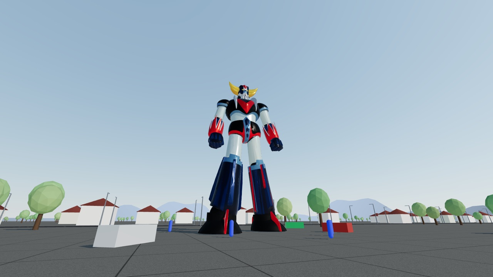
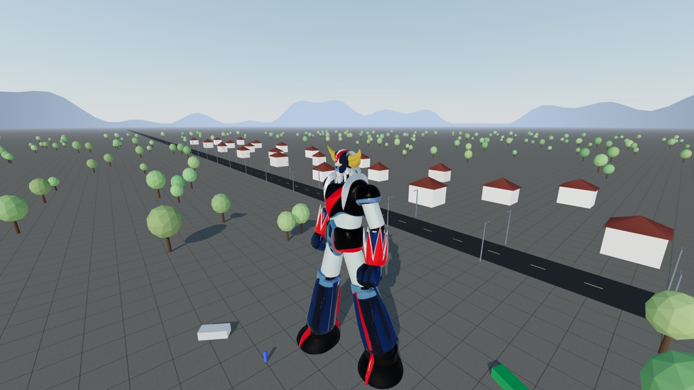
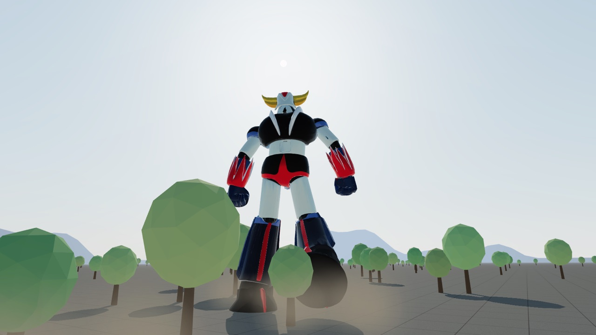
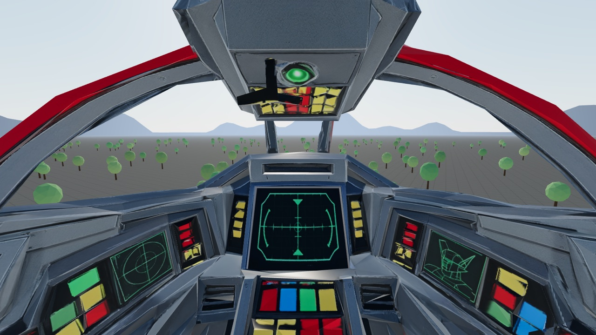
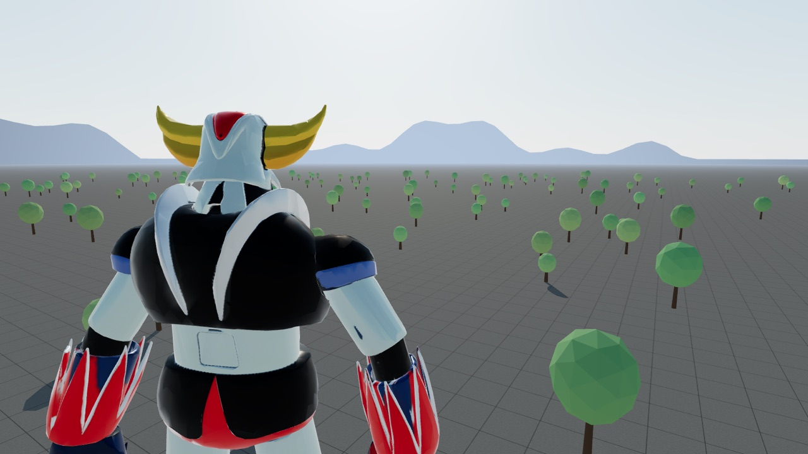

# Goldrake 1:1

A life-size, 30-metre Goldrake (Grendizer) you can walk around, fly up to with a jetpack, and pilot — in the browser or in a VR headset.

Everything runs from a single `index.html` using [three.js](https://threejs.org/) from a CDN; there is no build step.



## Screenshots

| | |
|---|---|
|  |  |
| **On foot** — jetpack up to head height | **Chase cam** — low and looking up as it strides through the trees |
|  |  |
| **Cockpit** — first-person from inside the head | **Shoulder cam · right** — robot to one side, path ahead clear |

## Features

- **On foot** — walk around the robot at human scale, with a jetpack to fly up and land on it. Trees, houses, lamp posts, cars and people give a sense of scale.
- **Pilot mode** — land on Goldrake's head (or press **F**) to take control. The robot walks and runs with mocap animation, heavy inertia, footfall dust, camera sway and low rumbling footsteps.
- **Six camera modes** while piloting:
  - **Chase cam** — low, over-the-shoulder, looking up at the robot
  - **Orbit cam** — classic third-person view from mid-height
  - **Cockpit** — first-person from inside the head, with a modelled cockpit interior
  - **Shoulder cam** — tight view of the back, shoulders and head
  - **Shoulder cam · right / left** — the same, with the robot to one side so the path ahead is clear
- **WebXR** — an **ENTER VR** button appears in VR-capable browsers (e.g. Meta Quest Browser), with full controller support.

## Controls

### Keyboard and mouse

| Input | On foot | Piloting |
|---|---|---|
| **W A S D** | move | walk / turn |
| **Shift** | run | run |
| **Mouse** / **arrow keys** | look | orbit camera (cockpit: look around) |
| **Space** (hold) | jetpack thrusters | — |
| **F** | board the robot | — |
| **R** | rotate robot 90° | — |
| **1** | — | cycle camera modes |
| **E** | — | eject |
| **C** | — | cockpit adjust mode (in cockpit camera) |
| **Esc** | pause | pause |

### VR controllers

| Input | On foot | Piloting |
|---|---|---|
| Left stick | move | walk / turn |
| Right stick ← → | snap turn | orbit camera (cockpit: look sideways) |
| Right stick ↑ ↓ | — | raise / lower orbit camera |
| Right trigger | jetpack thrusters | — |
| Grip | run | run |
| **A** | board the robot | — |
| **B** | — | cycle camera modes |
| **X** | rotate robot 90° | — |
| **Y** | — | eject |
| Left stick click | — | cockpit adjust mode (in cockpit camera) |

In VR, camera sway and roll are disabled for comfort; the cockpit and shoulder cams are the most comfortable views.

## Running locally

The models are loaded with `fetch`, so the page must be served over HTTP:

```sh
python3 -m http.server 8000
```

Then open <http://localhost:8000>.

### Testing in a headset

WebXR requires a secure context (HTTPS or `localhost`). The simplest option is to deploy to a static host — the repo is set up for [Netlify](https://www.netlify.com/): import the repository, leave the build command empty and set the publish directory to `.`. Every push to `main` then redeploys.

Alternatively, with a Quest in developer mode connected over USB:

```sh
adb reverse tcp:8000 tcp:8000
```

and open `http://localhost:8000` in the Quest Browser.

## Cockpit adjust mode

The cockpit eye point and scale can be tuned live from inside the cockpit camera (**C** on desktop, left stick click in VR). A panel shows the current values; nudge them with the keys/sticks, or in VR press **A** to make your current head position the eye point. Values are saved per device in `localStorage`; to make them the default for everyone, copy them into `COCKPIT_DEFAULT` in `index.html`.

## Assets

| File | Contents |
|---|---|
| `goldrake_anim.glb` | rigged robot with *Walking* and *Running* clips |
| `goldrake.glb` | static robot with the higher-quality baked material (same UV layout); its material is applied to the animated mesh |
| `cockpit.glb` | first-person cockpit interior (loaded in the background) |

Total download is about 62 MB.

## Tuning

Most behaviour is controlled by constants near the top of the relevant section in `index.html`, for example:

- `ROBOT_HEIGHT`, `WALK`, `RUN`, `THRUST`, `FUEL_BURN` — scale and on-foot physics
- `ANIM_SPEED`, `TURN_RATE` — robot gait and turning
- `CAM_MODES` — distance, height, field of view, side offset and lag for each camera mode
- `COCKPIT_DEFAULT` — cockpit eye point and scale
- `ARROW_YAW_RATE`, `ARROW_PITCH_RATE`, `VR_SNAP` — look speeds and VR snap-turn angle

Add `?debug` to the URL to expose internals on `window.gk` for testing.

## License

[MIT](LICENSE)
